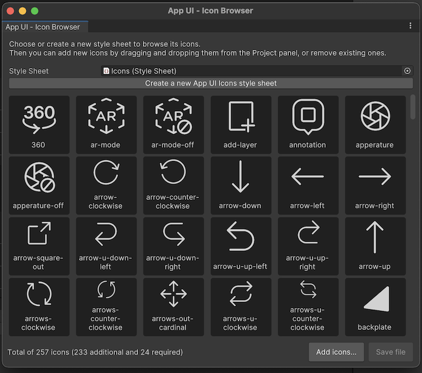

# Custom Icons

Every icon provided by App UI is available as an SVG file, imported by Unity's built-in
`SVGImporter` into a UI Toolkit `VectorImage`.
They are all referenced inside USS files, which are used to load the icons.

## Adding Custom Icons

To add a custom icon, you need to add an SVG file to your project and reference it in a USS file.

Select the `.svg` asset and, in the Inspector, set the importer's **Generated Asset Type** to
**UI Toolkit Vector Image** so it produces a `VectorImage`. The other importer settings can stay at
their defaults.

The naming convention used for the USS class name is `appui-icon--<name>--<variant in lowercase>`.

The variant by default is `Regular`, but you can use the following variants:

- `Regular`
- `Bold`
- `Light`
- `DuoTone`
- `Thin`
- `Fill`

Here's an example of how to add a custom icon named `home` with the `Regular` variant:

```css
.appui-icon--home--regular {
    --unity-image: url("path/to/home.svg");
}
```

> [!IMPORTANT]
> Your USS class name must start with `appui-icon--` followed by the name of your icon
> in order to work with the [Icon](xref:Unity.AppUI.UI.Icon) UI component.

Then you can use the `Icon` UI component to display the icon:

```xml
<appui:Icon name="home" variant="Regular" />
```

## Authoring the SVG

Two constraints come from the SVG importer, and both cause silent breakage rather than an obvious
failure:

- **Do not use `currentColor`.** The importer has no CSS context and rejects it
  (`currentColor is not supported as a fill value`), dropping that fill or stroke - the icon
  imports "successfully" but renders with missing geometry. Use a literal color.
- **Author monochrome glyphs in white** (`#FFFFFF`). App UI recolors icons at runtime with
  `--unity-image-tint-color`, which multiplies the icon's baked colors, so a white glyph takes the
  tint exactly while a black one stays black. Multi-color icons keep their own palette and are
  simply tinted on top.

`<filter>` elements are ignored by the importer. Masks, clip paths, gradients and strokes are all
supported.

## High DPI

Nothing to do. Icons are vector assets, so they are resolution independent and stay sharp at every
[IconSize](xref:Unity.AppUI.UI.IconSize) and on any display scale. The `@2x` companion files that
the previous PNG-based icons needed are no longer used.

For more information about this feature, please refer to [UI-Toolkit documentation](xref:UIE-USS-PropertyTypes).

## Icon Browser

The **Icon Browser** is an Editor tool that allows you to generate the USS classes
for your custom icons.

To open the **Icon Browser**, go to `Window > App UI > Icon Browser`.

<p align="center">
  
</p>

To use this tool you need to work on an existing USS file asset that includes only icons.
If you don't have one, you can create a new one by right-clicking in the Project window
and selecting `Create > App UI > Icon Stylesheet`.
You can also directly click on `Create a new App UI Icons style sheet`
button in the **Icon Browser** window.

Make sure the stylesheet (USS) asset is set in the **Icon Browser** window.

To include new Icons in this stylesheet, you can:
- Drag and drop icon assets from the Project window to the **Icon Browser** window.
- Click on the `Add Icons...` button in the **Icon Browser** window and select the icon asset.

> [!NOTE]
> When adding already existing assets as Icons via the **Icon Browser**,
> the tool expects that the **name of the folder containing the asset** is
> the **name of the icon's variant**.
> For example, if you have an asset named `home.svg` in a folder named `Regular`,
> the tool will generate the USS class `appui-icon--home--regular`.

> [!NOTE]
> App UI provides a set of icons that you can use in your project.
> You can find them in the `Packages/com.unity.dt.app-ui/PackageResources/Icons` folder.

### Dark artwork for a custom icon

If one of your icons needs different artwork on dark surfaces, add it next to the light one with a
`d_` prefix - `Regular/Diagram.svg` and `Regular/d_Diagram.svg`. The **Icon Browser** picks the pair
up on its own and generates `.light` and `.dark` blocks for it, so the icon follows the theme exactly
like the built-in colored icons. Icons with no `d_` sibling are generated unconditionally, as before.

Do this only for icons whose colors carry meaning. A monochrome glyph needs no dark artwork: author
it white and let `--unity-image-tint-color` recolor it, as described under
[Authoring the SVG](#authoring-the-svg).