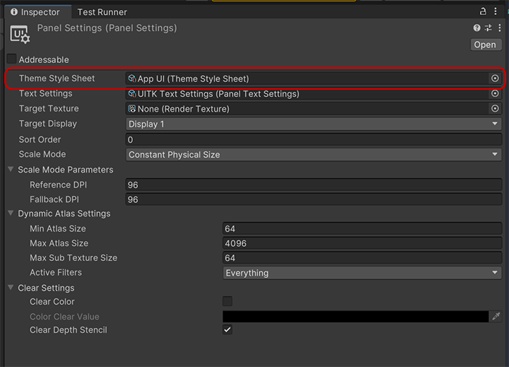
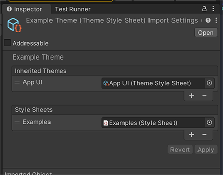
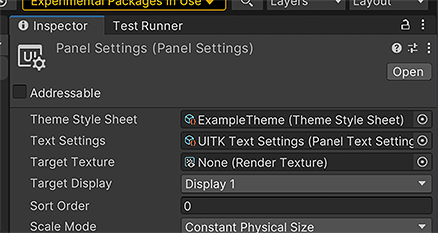

# Theming

The App UI theming system is based on USS variables and provides developers
the flexibility to customize the look and feel of their applications.
This system allows you to change colors, font sizes, font families,
and many other aspects of the user interface without having to modify
the application's source code.

## Theme files

A theme file is a set of USS variables that defines the colors and styles
used by the UI elements. These files are usually located in the `PackageResources/Styles/Themes`
directory and have the `.tss` extension. App UI provides a default theme file
called `App UI.tss`
which can be used as a starting point for customizing the theme.

## Using a theme

To apply the custom theme to your application,
you need to reference this Theme file inside the [PanelSettings](xref:UnityEngine.UIElements.PanelSettings)
used on your [UIDocument](xref:UnityEngine.UIElements.UIDocument) component.

<p align="center">
  
</p>

## Creating a theme

### With the Theme Builder

The quickest route is the [Theme Builder](https://app-ui.unity.com/theme-builder/), which derives a
complete theme from a handful of seed colours, previews it on real components and checks its
contrast. Export the theme as a `.appuitheme.json` file and drop that file anywhere in your
project: App UI imports it into a theme asset carrying two compiled stylesheets.

A Theme Builder theme is a family with a dark and a light appearance, and it exports one file per
appearance. A family called `ocean` gives `ocean-dark.appuitheme.json` and
`ocean-light.appuitheme.json`, whose theme names are `ocean-dark` and `ocean-light`: the same
`appui--<family>-<mode>` classes the web side uses. Besides App UI's own tokens, a file can carry
custom properties of your own (such as `--ocean-row-h`), written under their full name, and
metrics written as `var(--appui-sizing-*)` references so they follow the density. USS has no
`calc()` or `oklch()`, so a value it cannot read is left out of the file and listed under
`ussSkipped`.

To apply an imported theme, reference it from a component and hand its stylesheet to a panel:

```csharp
using Unity.AppUI.UI;
using UnityEngine;
using UnityEngine.UIElements;

public class ThemeSwitcher : MonoBehaviour
{
    [SerializeField]
    AppUIThemeAsset m_Theme;   // drag the imported .appuitheme.json here

    void Start()
    {
        var panel = GetComponent<UIDocument>().rootVisualElement.Q<Panel>();
        panel.styleSheets.Add(m_Theme.styleSheet);
        panel.theme = m_Theme.themeName;
    }
}
```

`AppUIThemeAsset` lives in App UI's runtime assembly, so this works in a build. Reference the theme
through a serialized field rather than looking it up with `AssetDatabase`, which exists only in the
editor.

Adding the stylesheet this way layers the theme over whichever App UI theme is already loaded, so
any token the custom theme does not define keeps its value from the base theme. The imported asset
also carries a `themeStyleSheet`, which can be assigned to
[PanelSettings](xref:UnityEngine.UIElements.PanelSettings) instead to replace the theme file
entirely.

Imported themes also appear in the theme dropdown wherever a `Panel` or `ContextProvider` is edited
in the inspector.

### By hand

A theme is only USS, so it can equally be written by hand. Create 2 files:
- A Stylesheet file (`.uss`) that will contains all the the theming variables.
- A Theme file (`.tss`) that will reference the stylesheet file.

### Stylesheet file

The stylesheet file will have a set of USS variables that defines the colors and styles.

Here is an example of a stylesheet file for a custom theme named `darkBlue`:

```css
.appui--darkBlue {
    --appui-primary-100: #E3F2FD;
    ...
}
```

> [!IMPORTANT]
> You must use the `appui--` prefix for your theme name, since it
> is used by the App UI context provider to identify the theme.

> [!NOTE]
> Name a dark theme with a `dark` suffix, as in `acme-dark`. App UI then also applies the `dark`
> marker class, so anything styled for dark surfaces - the built-in icon artwork included - picks
> your theme up without any extra work. See
> [light and dark contexts](xref:contexts#light-and-dark-contexts).

> [!NOTE]
> If you want a complete override of the default theme, we recommend to
> copy the default theme stylesheet file and modify it.
> The default theme file is `App UI - Dark.class.uss`.

### Theme file

The theme file will reference the stylesheet file and will be used
on the [PanelSettings](xref:UnityEngine.UIElements.PanelSettings) of your
[UIDocument](xref:UnityEngine.UIElements.UIDocument) component.

Here is an example of a theme file for the `darkBlue` theme:

```css
@import url("unity-theme://default");
@import url("/Packages/com.unity.dt.app-ui/PackageResources/Styles/Themes/App UI - Globals.uss");
@import url("/Packages/com.unity.dt.app-ui/PackageResources/Styles/Themes/App UI - Alias.uss");
@import url("/Packages/com.unity.dt.app-ui/PackageResources/Styles/App UI.uss");

@import url("darkBlue.uss");

VisualElement {}
```

The App UI imports come first so that the theme's own variables win, and the trailing empty rule is
required: Unity's theme importer needs at least one rule to produce a valid theme asset. Leaving the
App UI imports out gives a panel the theme's variables but none of App UI's component styles.

You can also use the Editor inspector panel for editing the theme file:

<p align="center">
  
</p>

When all the theme files are ready, you can reference the theme file
in the [PanelSettings](xref:UnityEngine.UIElements.PanelSettings) of your
[UIDocument](xref:UnityEngine.UIElements.UIDocument) component:

<p align="center">
  
</p>


